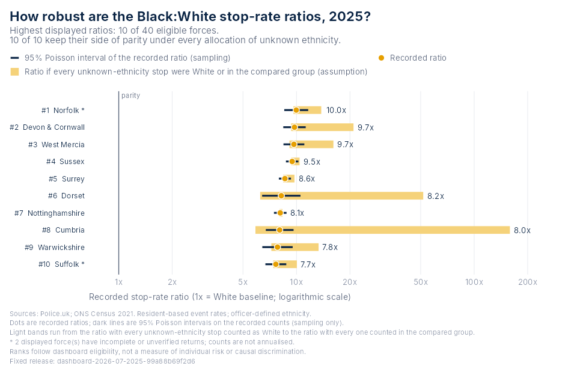

# BlackThriveSS

**Reproducible stop and search evidence for England and Wales, in R.**

BlackThriveSS bundles a catalogue of fixed, checksummed datasets extracted
from the Black Thrive stop and search dashboard (force, council and national
tables from 2018 onwards, with monthly reporting coverage) and the tools to
turn them into evidence that can be checked: the dashboard's ranking chart
for any year and group, bounds on every ratio under missing ethnicity, rank
intervals, trends and year-on-year change with coverage attached, plain
statements and HTML briefings for one force or council, and saved views that
replay any chart with identical numbers. Everything runs offline.

The snapshots were extracted from `btg_stop_search_v9`. They use the local
dashboard's July 2026 Police.uk source release, built in September 2026, and
Census 2021 populations. The package does not query the live website.

## Who it is for

**Researchers and analysts** get tidy data frames with provenance, the
documented calculations behind every number, sensitivity and stability
analyses that keep sampling variability apart from assumptions, ggplot
objects they can edit, and views and exports that make a result
reproducible by someone else.

**Policy, scrutiny and community users** get one call that writes the
evidence for their area as careful plain statements, charts with the area
highlighted, an HTML briefing with the methods and their limits attached,
and a glossary with one definition per term.

## The catalogue

```r
library(BlackThriveSS)
btg_datasets()
#   dataset                   level    from   to   groups                      coverage
#   force_disparity           force    2025 2025   Black                       TRUE
#   force_ethnicity_year      force    2018 2026   Asian, Black, Mixed, Other  TRUE
#   national_year             national 2018 2026                               FALSE
#   national_month_ethnicity  national 2018 2026   Asian, ..., White, Unknown  FALSE
#   council_ethnicity_year    council  2018 2026   Asian, Black, Mixed, Other  FALSE
#   hit_rate_ethnicity_year   national 2018 2026   Asian, ..., White, Unknown  FALSE
#   section60_force_year      force    2018 2026   Asian, ..., White, Unknown  TRUE

y <- btg_get_data("force_ethnicity_year", groups = "Black", years = 2022:2025)
y$data[c("force_label", "year", "ratio", "rank", "coverage_status")]
btg_get_data("council_ethnicity_year", council = "E09000022")$data   # Lambeth
btg_get_data("national_year")$data
```

Every dataset is read the same way, verified against its SHA-256 checksum,
and carries the release's provenance in `$metadata`. The dashboard verifies
monthly submissions only inside a recent window, so earlier years are
`unverified`, which is not the same as missing; a missing return is always
`NA`, never zero. `btg_validate()` audits any dataset's integrity, totals and
calculations.

## Charts

| Function | Draws |
|---|---|
| `btg_plot_disparity()` | The dashboard's force ranking for any year and group, with intervals, coverage marks and a highlighted force |
| `btg_plot_sensitivity()` | The same forces with their sampling interval and the range of the ratio under every allocation of unknown-ethnicity stops |
| `btg_plot_trend()` | A force's or council's ratios or rates over the years, national monthly stops or shares, national totals and rates, outcome-linked search rates, Section 60 searches |
| `btg_plot_change()` | A dumbbell chart of the largest changes in ratio between two years |

Each chart is an ordinary ggplot. `btg_figure_data()` returns the table
behind it, `btg_save_view()` pins it to a release and `btg_from_view()`
replays it. Groups keep fixed colours from `btg_group_colours()`.

```r
x <- btg_get_data()
btg_plot_disparity(x)
btg_plot_sensitivity(x)
btg_plot_trend(btg_get_data("force_ethnicity_year", force = "metropolitan"))
btg_plot_change(btg_get_data("force_ethnicity_year"))
```



## How robust is a comparison?

Three kinds of uncertainty are reported separately and never combined:
sampling variability, the allocation of stops with no recorded ethnicity,
and missing monthly returns.

```r
s <- btg_sensitivity(x)        # ratio_min, ratio_max, parity_direction, rank_best, rank_worst
r <- btg_rank_stability(x)     # rank_lower, rank_upper, prob_top from seeded Poisson draws
ch <- btg_change(btg_get_data("force_ethnicity_year", groups = "Black"))   # change, interval, coverage
```

`vignette("robustness", package = "BlackThriveSS")` works through all of
them across every year and group.

## Brief one force or council

```r
p <- btg_profile(force = "metropolitan")
p                                  # plain statements, each with its qualification
p$comparisons                      # the numbers behind them
btg_report(force = "metropolitan", file = "metropolitan-2025.html")
btg_report(council = "E09000022", file = "lambeth-2025.html")
```

The briefing is a self-contained HTML file: statements, charts with the
area highlighted, tables, monthly coverage, national context, how to read
it, and the code and citations that reproduce every figure. It needs the
rmarkdown package and Pandoc, which RStudio and Positron include. The same
template appears in those editors as "BlackThriveSS briefing". See
`vignette("briefing", package = "BlackThriveSS")`.

## Round-trip with the dashboard website

```r
p <- btg_plot_disparity(btg_get_data("force_ethnicity_year"),
                        year = 2024, group = "Asian", highlight = "metropolitan")
btg_dashboard_url(p)
#> https://.../?tab=disparity&year=2024&eth=Asian&def=std&view=chart&force=Metropolitan%20Police

back <- btg_from_url("https://.../?tab=disparity&year=2024&eth=Asian&view=chart&force=Metropolitan%20Police")
identical(btg_figure_data(back), btg_figure_data(p))
#> TRUE
```

`btg_dashboard_url()` opens the Disparity page at the chart's year, group and
selected force. `btg_from_url()` reproduces the chart behind any link copied
from the website's Share view button and warns when the link was made from a
different source month. A link selects a view; the website recomputes from its
current release, while the chart in R stays pinned to the bundled snapshot.

## Take the evidence with you

```r
btg_export(btg_get_data(force = "metropolitan"), "metropolitan-2025.csv")
# writes the CSV, a coverage CSV and a JSON sidecar with release, checksums,
# selection, citation and limitations
btg_glossary()
btg_citation(x)
```

## Try it in R

Open `BlackThriveSS.Rproj` and run the following in a fresh R session. The
installer verifies the source archive, installs missing required dependencies
from CRAN, and puts the package into this project's `artifacts/library` folder.
It does not require devtools or a running dashboard.

```r
source("install.R")
install_blackthrivess()
library(BlackThriveSS)

x <- btg_get_data()
p <- btg_plot_disparity(x)
p

x$data                      # Ordinary data frame: all 44 forces
btg_figure_data(p)           # Original chart table, in display order
btg_coverage(x)              # 528 monthly reporting observations
btg_metadata(x)$source      # Source release, retrieval time and checksum
btg_citation(x)
btg_validate(x)              # Integrity, coverage and accounting checks
```

To share this development build for testing, use the installation ZIP in
`artifacts/`. Extract it into a folder and follow `START-HERE.txt`; the full
development project is not needed. The archive and manifest must stay
together. This is a local release, not a published CRAN package. Do not use
`install.packages("BlackThriveSS")` yet.

For a different writable library, supply `lib = "/your/library"`. With all
required dependencies already available, `dependencies = FALSE` performs an
offline installation. The package itself contains no compiled code.

When reopening R, enable the local library and load the package:

```r
.libPaths(c(normalizePath("artifacts/library"), .libPaths()))
library(BlackThriveSS)
vignette("getting-started", package = "BlackThriveSS")
```

Full function help is available with `help(package = "BlackThriveSS")`.
Developers can instead use `pkgload::load_all()` from the project folder.

## Save and reproduce a chart

```r
btg_save_view(p, "my-disparity-view.json")
recreated <- btg_from_view("my-disparity-view.json")
stopifnot(identical(btg_figure_data(p), btg_figure_data(recreated)))

# This example is installed with the package:
view <- system.file("examples", "disparity-2025.json", package = "BlackThriveSS")
btg_from_view(view)
```

The JSON file pins the data release, payload checksums, chart version,
selection and settings. Unknown releases, schemas or checksums fail
explicitly. Files never execute R code or trigger downloads. Numerical
reproduction is supported; pixel-identical rendering requires the same
graphics environment. Custom ggplot styling and layers are not stored.

## What is reproduced, and what is not

The ranking chart reproduces the force selection, ratios and ordering of the
dashboard's Disparity page. Forty forces have ratios eligible under the
dashboard's display rules in 2025. British Transport Police and City of
London have no displayed resident-based rate. Greater Manchester and Gwent
have no submitted 2025 months in this snapshot; their counts remain `NA`,
not zero. Partial returns remain visible and are marked.

These are event rates using fixed 2021 resident populations, not probabilities
that an individual will be stopped. Officer-defined ethnicity and Census
self-reported ethnicity are different classifications. The table does not
separate vehicle-only searches, so unknown ethnicity is not a pure non-response
measure. Ratios, ranks and changes are descriptive and do not establish
discrimination. See the installed `NOTES/data-dictionary.md`, `btg_glossary()`
and the explicit metadata for definitions and limits.

## Development and verification

```r
roxygen2::roxygenise()
testthat::test_local()
```

From a shell, with R available:

```text
Rscript --vanilla dev/verify-dashboard.R ../btg_stop_search_v9
Rscript --vanilla dev/reproduce.R
R CMD build .
R CMD check --as-cran BlackThriveSS_*.tar.gz
```

`dev/verify-dashboard.R` compares the package's tables with the dashboard's
own calculation functions. Tests use hand-calculated fixtures, cover missing
returns, zero counts and excluded denominators, reject changed provenance,
and exercise saved-view replay, bounds, rank intervals, change, trends,
profiles, exports and the briefing. Parity validates reproduction, not the
original data's completeness or all of the dashboard's statistical
assumptions.

`data-raw/build-snapshot.R` and `data-raw/build-catalogue.R` create
content-identified releases from the dashboard files. Existing release
directories are never overwritten. See `CRAN-READINESS.md` for the evidence
and remaining release gates, and `CONTRIBUTING.md` for development rules.

The **Use in R dashboard button is deferred**. This is a local development
package: it has not been submitted to CRAN, and it does not change the
dashboard deployment.

## Attribution

Code: MIT, Black Thrive Global. Public aggregate data: Police.uk and Office for
National Statistics, Census 2021, via the dashboard preparation pipeline.
Contains public sector information licensed under the [Open Government Licence
v3.0](https://www.nationalarchives.gov.uk/doc/open-government-licence/version/3/).

Source documentation: [Police.uk](https://data.police.uk/about/) and
[Census 2021](https://www.nomisweb.co.uk/sources/census_2021).
