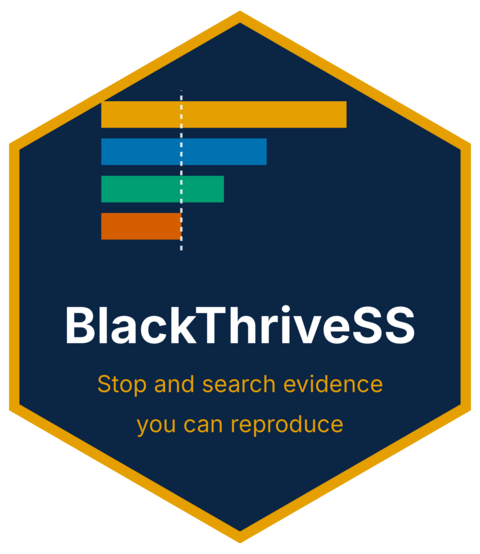
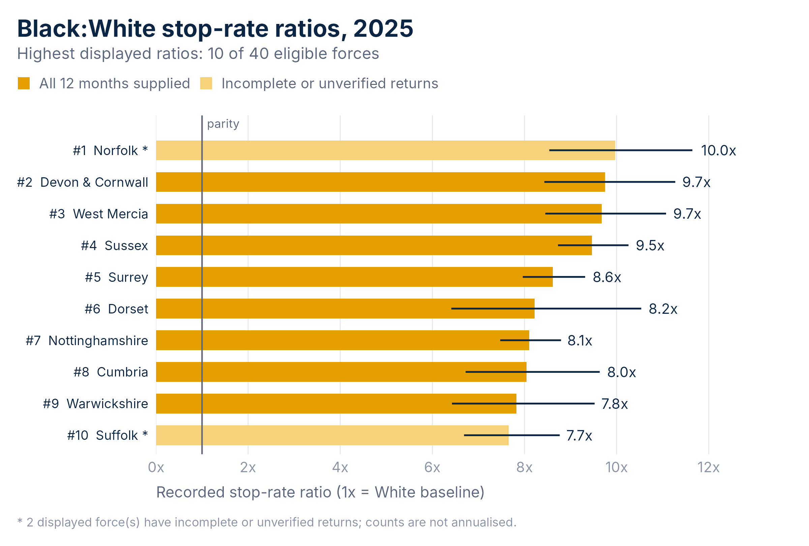
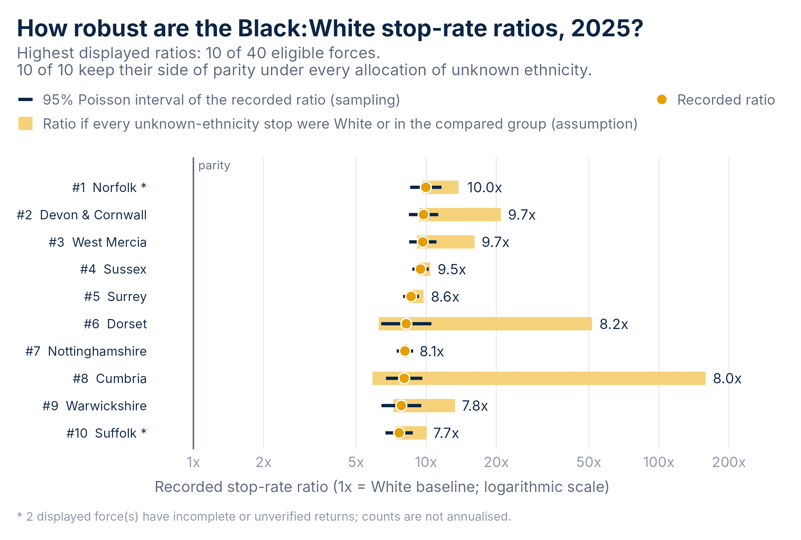
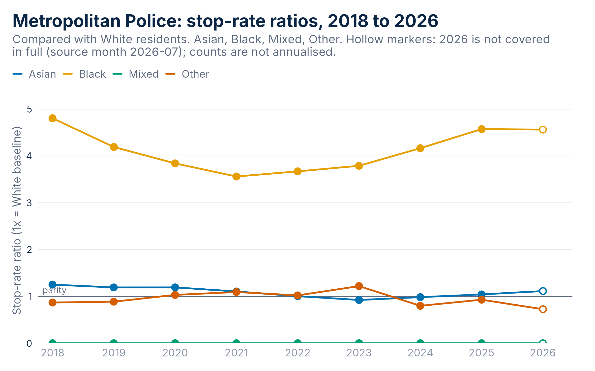
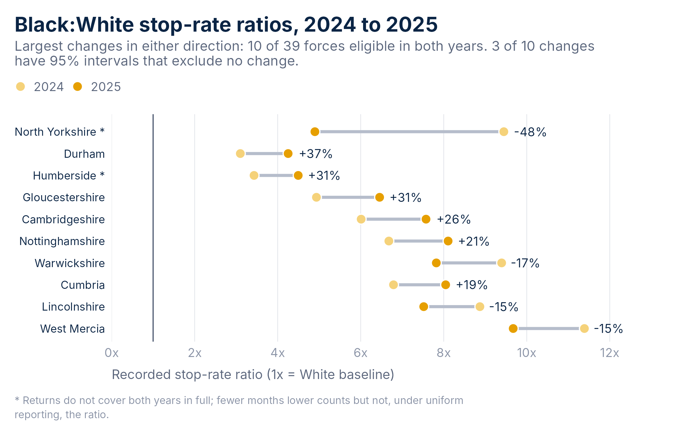

<!-- badges: start -->
[](https://github.com/BlackThrive/BlackThriveSS/actions/workflows/R-CMD-check.yaml)
[](https://github.com/BlackThrive/BlackThriveSS/actions/workflows/pkgdown.yaml)
<!-- badges: end -->

<div class="btg-hero">
<div class="btg-hero-body">
<p class="btg-kicker">An R package from Black Thrive Global</p>
<p class="btg-hero-title">Stop and search evidence you can reproduce</p>
<p class="btg-hero-lead">Fixed, checksummed releases of public Police.uk and Census data for every police force and council in England and Wales, with the charts, robustness checks and briefings that turn them into evidence that stands up to scrutiny.</p>
<div class="btg-hero-actions">
<a class="btn btg-btn-amber btn-lg" href="articles/getting-started.html">Get started</a>
<a class="btn btn-outline-light btn-lg" href="#install">Install</a>
<a class="btn btn-link btg-link-light btn-lg" href="https://bgtresearch-stop-search-dashboard.share.connect.posit.cloud/">Open the dashboard</a>
</div>
</div>

</div>

<div class="btg-stats">
<div class="btg-stat"><span class="btg-stat-value">44</span><span class="btg-stat-label">police forces</span></div>
<div class="btg-stat"><span class="btg-stat-value">355</span><span class="btg-stat-label">councils</span></div>
<div class="btg-stat"><span class="btg-stat-value">9</span><span class="btg-stat-label">years of monthly data, 2018 to 2026</span></div>
<div class="btg-stat"><span class="btg-stat-value">7</span><span class="btg-stat-label">datasets, one citation each</span></div>
</div>

## What it gives you

<div class="row row-cols-1 row-cols-md-2 g-4 btg-features">
<div class="col"><div class="btg-feature"><div class="btg-feature-icon"><i class="fa-solid fa-database" aria-hidden="true"></i></div><h3>Data that stays put</h3><p>Seven datasets, pinned to a named release with SHA-256 checksums, monthly reporting coverage and a ready-made citation. A chart made today matches the same chart made next year.</p></div></div>
<div class="col"><div class="btg-feature"><div class="btg-feature-icon"><i class="fa-solid fa-chart-bar" aria-hidden="true"></i></div><h3>The dashboard's charts, editable</h3><p>Recreate the force ranking for any year and group as an ordinary ggplot, with intervals, coverage marks and a highlighted force. Every chart carries its own table.</p></div></div>
<div class="col"><div class="btg-feature"><div class="btg-feature-icon"><i class="fa-solid fa-scale-balanced" aria-hidden="true"></i></div><h3>Robustness, kept honest</h3><p>Sampling intervals, bounds under every allocation of unknown ethnicity and rank intervals are reported side by side and never combined, so a reader can see what a comparison rests on.</p></div></div>
<div class="col"><div class="btg-feature"><div class="btg-feature-icon"><i class="fa-solid fa-chart-line" aria-hidden="true"></i></div><h3>Nine years of change</h3><p>Ratios and rates over time for any force or council, national monthly series and Section 60 searches, with incomplete periods marked and nothing annualised.</p></div></div>
<div class="col"><div class="btg-feature"><div class="btg-feature-icon"><i class="fa-solid fa-file-lines" aria-hidden="true"></i></div><h3>A briefing in one call</h3><p>Plain statements that carry their own qualifications, and a styled HTML, Word or PDF briefing for one force or council, with numbered tables, page-width figures and the code to reproduce them.</p></div></div>
<div class="col"><div class="btg-feature"><div class="btg-feature-icon"><i class="fa-solid fa-rotate" aria-hidden="true"></i></div><h3>Replay and share</h3><p>Saved views replay a chart with identical numbers. Links round-trip to the dashboard website. Exports carry a provenance sidecar so a CSV still says where its numbers came from.</p></div></div>
</div>

## See it

<div class="row row-cols-1 row-cols-lg-2 g-4 btg-gallery">
<figure class="col"><a href="reference/figures/home-ranking.png"></a><figcaption>The dashboard's ranking chart for any year and group, with 95% intervals and marks for incomplete returns.</figcaption></figure>
<figure class="col"><a href="reference/figures/home-sensitivity.png"></a><figcaption>How robust each ratio is: the sampling interval beside the range it could take if every unknown-ethnicity stop were reassigned.</figcaption></figure>
<figure class="col"><a href="reference/figures/home-trend.png"></a><figcaption>Ratios over nine years for one force, with hollow markers where the year is incomplete.</figcaption></figure>
<figure class="col"><a href="reference/figures/home-change.png"></a><figcaption>The largest year-on-year changes, each with an interval and the coverage of both years.</figcaption></figure>
</div>

## Install

BlackThriveSS is not on CRAN yet. Install the current release from GitHub with R 4.1 or newer:

```r
install.packages("remotes")
remotes::install_github("BlackThrive/BlackThriveSS")
```

The package contains no compiled code and runs offline after installation. Briefings in HTML and Word need Pandoc, which RStudio and Positron include; PDF briefings also need a LaTeX installation such as TinyTeX.

## Quick start

```r
library(BlackThriveSS)

x <- btg_get_data("force_disparity", years = 2025)   # the fixed 2025 Black:White comparison
p <- btg_plot_disparity(x, n = 10)                    # the dashboard's ranking chart
btg_figure_data(p)                                    # the table behind it
btg_sensitivity(x)                                    # bounds under unknown ethnicity
btg_report(force = "metropolitan", file = "metropolitan-2025.docx")   # a Word briefing
```

Three guides take it from there: [reproduce and validate a chart](articles/getting-started.html), [test how robust a comparison is](articles/robustness.html) and [brief a force or council](articles/briefing.html). The [function reference](reference/index.html) documents every call.

## Who it is for

<div class="row row-cols-1 row-cols-md-3 g-4 btg-audience">
<div class="col"><h3>Researchers</h3><p>Tidy data frames with provenance, documented calculations behind every number, and views and exports that let someone else reproduce a result exactly.</p></div>
<div class="col"><h3>Policy and scrutiny</h3><p>One call writes the evidence for an area as careful plain statements, with the methods and their limits attached, ready for a scrutiny panel or a consultation response.</p></div>
<div class="col"><h3>Community organisations</h3><p>Charts with your force or council highlighted, a glossary with one definition per term, and a link that opens the same view on the dashboard website.</p></div>
</div>

## Read the numbers with care

<div class="btg-callout">
<p>The ratios compare recorded stops with Census 2021 resident populations. They are descriptive event rates, not the probability that a person will be stopped, and they do not on their own establish discrimination. Officer-defined ethnicity differs from Census self-reported ethnicity, the aggregate cannot separate vehicle-only searches, and some forces supply incomplete monthly returns, which the package marks rather than hides. The <a href="reference/btg_glossary.html">glossary</a>, the <a href="articles/robustness.html">robustness guide</a> and every dataset's metadata set out these limits.</p>
</div>

## Cite it

```r
citation("BlackThriveSS")   # the package
btg_citation(x)             # the data release behind an object
```

Code: MIT, Black Thrive Global. Data: Police.uk stop and search records and Office for National Statistics Census 2021 populations, which contain public sector information licensed under the [Open Government Licence v3.0](https://www.nationalarchives.gov.uk/doc/open-government-licence/version/3/).
